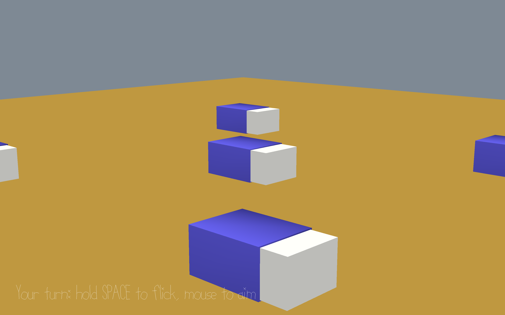

# Keshi Battle

Author: Mikhail Titov

Design: This is a simple Keshigomu (Eraser) battle game where you flick an eraser to knock off opponent's erasers.

Screen Shot:

How To Play:

Aim using mouse / track pad and use space bar to flick the eraser. You can hold the space bar to increase the flicking power. You will win once you knock all 4 opponent's eraser, and you will lose if you get knocked off. 

This game was built with [NEST](NEST.md).
